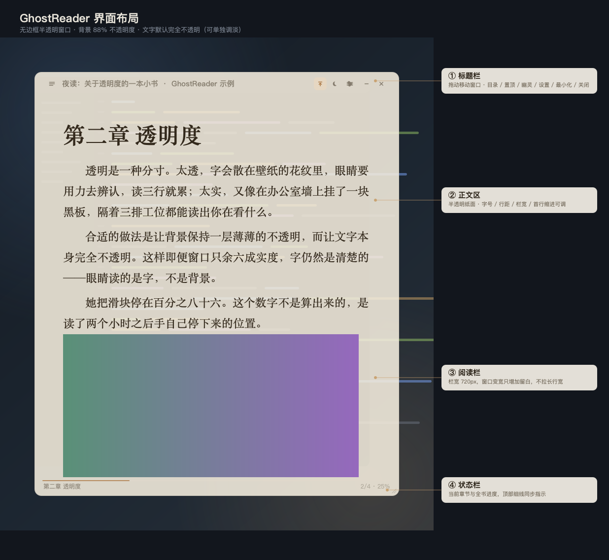
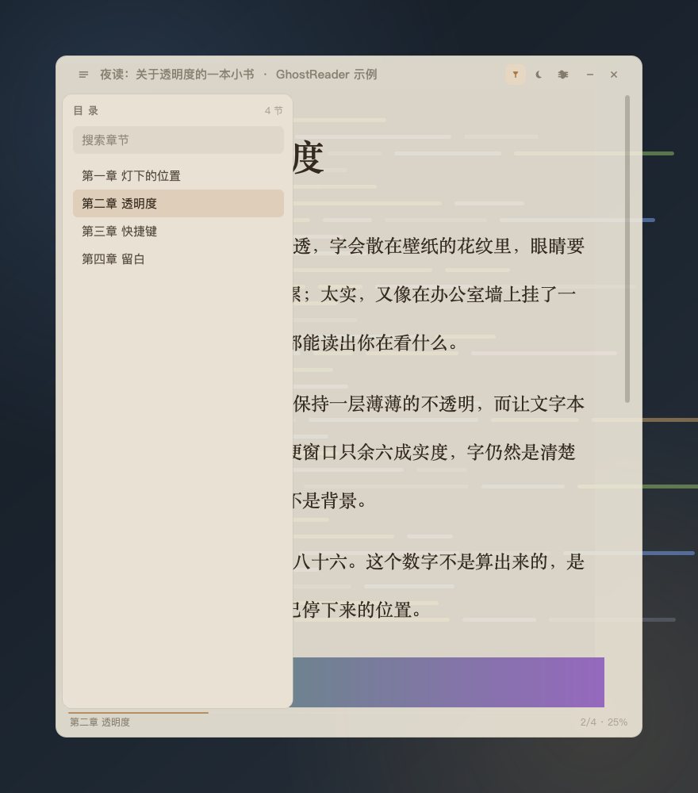
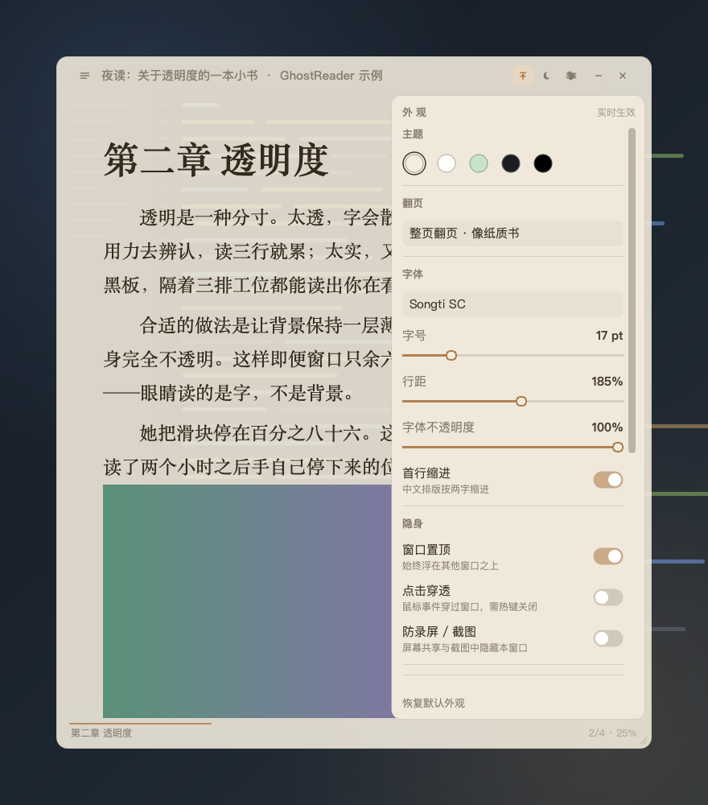
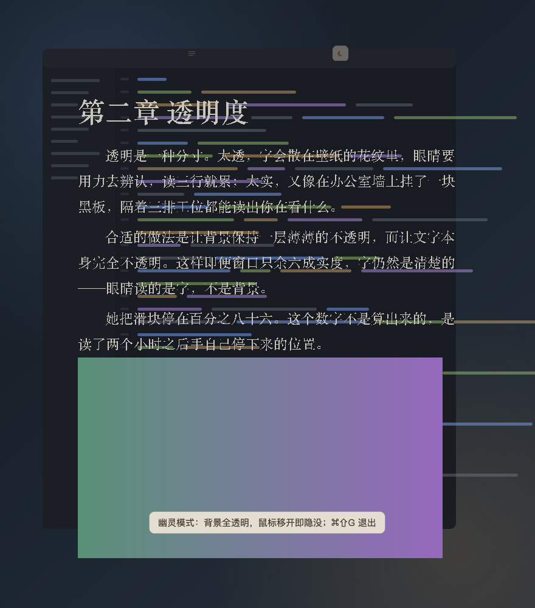
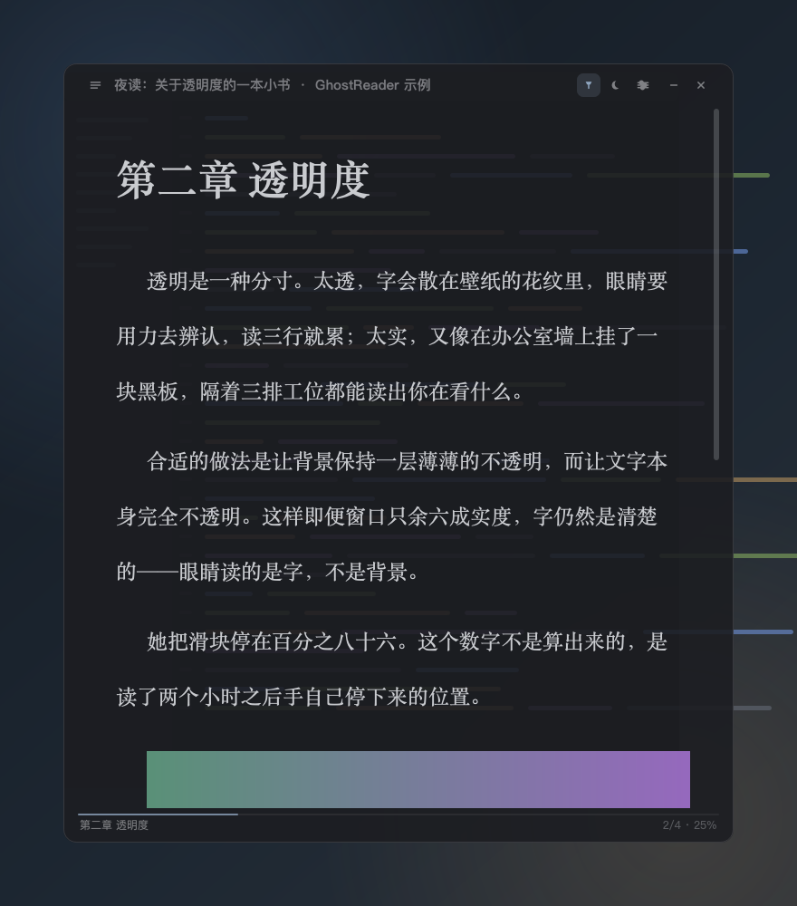

# GhostReader · 半透明隐身 EPUB 阅读器

一款本地运行的桌面 EPUB 阅读器：窗口半透明、无边框、可一键隐没，正文排版按中文长文调优。
纯 Python + PyQt6 实现，EPUB 解析只用标准库，不依赖任何电子书 SDK，也没有任何联网行为。



---

## 1. 功能范围

### 1.1 阅读

| 能力 | 说明 |
| --- | --- |
| 格式 | EPUB 2 / EPUB 3 流式排版（`container.xml` → OPF → spine） |
| 目录 | 解析 EPUB3 `nav` 与 EPUB2 `NCX`，支持层级与关键词过滤 |
| 翻页 | 默认**整页翻页**（按行对齐，不切半行）：空格 / PageDown / 滚轮 / 点击左右两侧都能翻；可切回连续滚动 |
| 章节 | 目录跳转、左右方向键翻章、书内链接跳转、翻到章末自动进下一章 |
| 进度 | 按书保存"章节 + 章内位置"，重启后回到原处；状态栏显示全书百分比 |
| 配图 | 内嵌图片按正文栏宽等比缩放，窗口缩放后重新适配 |
| 打开方式 | 文件对话框、拖拽 `.epub` 到窗口、命令行参数、双击 `.app` 关联 |

### 1.2 外观（全部实时生效）

- **字体**：从系统可用字体中挑选（默认宋体 `Songti SC`），可换黑体/楷体/西文衬线。
- **字号** 11–40 pt；**行距** 120%–240%；**首行缩进** 开关（中文两字）。
- **正文栏宽** 360–1200 px、**页边距** 12–120 px：窗口变宽时只增加留白，不把一行拉长。
- **窗口宽度 / 高度**：设置面板里直接拖，拖窗口边缘时滑块会跟着变；上限自动限制在屏幕可用区域内。
- **背景色**：羊皮纸 / 素白 / 护眼绿 / 暗夜 / 纯黑 五套预设。
- **背景不透明度** 15%–100%，**整窗不透明度** 30%–100%，**字体不透明度** 25%–100%，三者独立。
- **低透明度自动补底**：背景透明度越低，纸面自动越实，保证文字不糊（见 §4.1）。

### 1.3 隐身

| 能力 | 说明 |
| --- | --- |
| 无边框半透明窗口 | 圆角卡片，无系统标题栏，不显示任何阅读类界面元素 |
| 一键隐藏 | 全局热键 / `Esc` / 托盘，窗口从屏幕与任务栏消失，再按一次原位恢复 |
| 幽灵模式 | 背景彻底透明，只剩文字浮在桌面上；鼠标移开整窗隐没，移回即显形 |
| 幽灵模式目录 | 幽灵模式下仍保留 ☰ 按钮，可直接选章节；抽屉打开时窗口不会隐没 |
| 点击穿透 | 鼠标事件穿过窗口落到下层应用，适合"贴在屏幕角落"阅读 |
| 防录屏 / 截图 | macOS `NSWindow.sharingType=None`、Windows `WDA_EXCLUDEFROMCAPTURE` |
| 窗口置顶 | 始终浮于其他窗口之上 |
| 位置记忆 | 记住窗口位置、尺寸与每本书的阅读进度 |

> 定位说明：这些能力用于**减少阅读对同事与屏幕共享的干扰**，不涉及、也不提供任何规避企业审计或监控的功能。

### 1.4 明确不支持

- 带 DRM 的电子书（Adobe ADEPT、Kindle 等）。
- 固定版式 EPUB（`rendition:layout=pre-paginated`）、漫画/画册类以图为主的排版。
- EPUB 内复杂 CSS（多栏、绝对定位、自定义字体文件）会被简化为流式文本。
- 全文检索、批注、多书书架（当前只记录"上一本"）。

---

## 2. 界面布局

窗口是**一张半透明纸卡**，从上到下四层，没有多余装饰：

```
┌───────────────────────────────────────────────┐
│ ☰  书名 · 作者              置顶 ☾ ⚙ － ✕    │  ← ① 标题栏 40px
├───────────────────────────────────────────────┤
│                                               │
│   第二章 透明度                               │  ← ② 正文区
│                                               │     栏宽 720px 居中
│   透明是一种分寸。太透，字会散在壁纸的花纹里…  │     两侧留白随窗口增长
│                                               │
│                                               │  ← ③ 滚动条（10px，低对比）
├───────────────────────────────────────────────┤
│ 第二章 透明度                    2/4 · 25%    │  ← ④ 状态栏 26px
└───────────────────────────────────────────────┘
   ↑ 窗口外缘 10px 为拖拽缩放判定区
```

- **① 标题栏**：左端目录按钮，中间书名与作者（过长省略），右端依次为置顶、幽灵模式、外观设置、最小化、关闭。整条可拖动窗口，双击切换幽灵模式。
- **② 正文区**：唯一的内容层。文字始终完全不透明，只有背景参与透明。
- **③ 滚动条**：默认近乎隐形，悬停时加深，不打断阅读。
- **④ 状态栏**：左为当前章节名，右为"第几节 / 共几节 · 全书百分比"，顶部 2px 细线是进度条。
- **抽屉**：目录从左侧滑入（292px），外观设置从右侧滑入（316px），都覆盖在正文之上，`Esc` 关闭。

| 目录抽屉 | 外观设置 | 幽灵模式 |
| --- | --- | --- |
|  |  |  |

暗色主题下窗口几乎与深色桌面融为一体：



---

## 3. 主要交互方式

### 3.1 鼠标

| 操作 | 结果 |
| --- | --- |
| 拖标题栏 | 移动窗口 |
| 拖窗口任意边缘 6px | 调整大小（8 个方向） |
| 滚轮 | 整页翻页（连续滚动模式下为滚动） |
| 点击正文左 1/3 | 上一页 |
| 点击正文右 1/3 | 下一页 |
| `Ctrl/⌘` + 滚轮 | 直接调字号 |
| 双击标题栏 | 进入 / 退出幽灵模式 |
| 单击托盘图标 | 显示 / 隐藏窗口 |
| 右键托盘图标 | 菜单：打开、幽灵模式、置顶、设置、退出 |
| 拖 `.epub` 进窗口 | 打开该书 |

### 3.2 键盘（窗口聚焦时）

| 按键 | 作用 |
| --- | --- |
| `Space` / `PageDown` / `J` | 下一页 |
| `PageUp` / `K` | 上一页 |
| `↑` `↓` | 按行滚动 |
| `←` `→` | 上一章 / 下一章 |
| `Home` / `End` | 章首 / 章末 |
| `Esc` | 先关抽屉；无抽屉时隐藏窗口 |
| `Ctrl/⌘ + O` | 打开 EPUB |
| `Ctrl/⌘ + Q` | 退出 |

### 3.3 全局热键（窗口未聚焦、甚至已隐藏时也可用）

| 组合 | 作用 | 说明 |
| --- | --- | --- |
| `⌘⇧H` / `Ctrl+Shift+H` | **隐藏 / 显示** | 核心"老板键"，按一下整窗消失 |
| `⌘⇧G` / `Ctrl+Shift+G` | 幽灵模式 | 背景全透明，鼠标移开即隐没 |
| `⌘⇧J` / `Ctrl+Shift+J` | 点击穿透 | 鼠标可点穿到下层 |
| `⌘⇧T` / `Ctrl+Shift+T` | 置顶开关 | |
| `⌘⇧L` / `Ctrl+Shift+L` | 目录 | |
| `⌘⇧K` / `Ctrl+Shift+K` | 外观设置 | |
| `⌘⇧=` / `⌘⇧-` | 字号 ±1 | |
| `⌘⇧↑` / `⌘⇧↓` | 背景不透明度 ±5% | |
| `⌘⇧←` / `⌘⇧→` | 正文栏宽 ±40px | |

> 全局热键依赖 `pynput`。macOS 首次使用需在 **系统设置 → 隐私与安全性 → 辅助功能** 中勾选终端（或 GhostReader.app）；未授权时自动降级为"仅窗口内快捷键"，功能不受影响，只是隐藏后需要点托盘图标恢复。

---

## 4. 默认参数建议

### 4.1 透明度：默认 **背景 88% + 整窗 100%**

两个滑块解决的是两件事，建议分开理解：

- **背景不透明度**：只让"纸"变透明，文字本身始终 100% 实色。这是日常该调的那个。
- **整窗不透明度**：连文字一起变淡，只在"幽灵模式"这类需要整体退到背景里的场景使用。

为什么默认 88% 而不是更透？按默认羊皮纸 `#F4EDDF` 与文字 `#33291C` 实测（WCAG 对比度，最坏情况是深色桌面）：

| 背景不透明度 | 深色桌面上的正文对比度 | 观感 |
| --- | --- | --- |
| 100% | 12.2 : 1 | 实体纸张 |
| **88%（默认）** | **9.7 : 1** | 能看出身后有东西，但字依然锐利 |
| 80% | 8.3 : 1 | 透视明显，仍轻松可读 |
| 70% | 6.6 : 1 | 长读开始费眼 |
| 55% | 4.7 : 1 | 只适合扫一眼 |
| 50% | 4.0 : 1 | 低于 WCAG AA |

结论与建议：

- **日常默认 88%**：明显低于 AAA 门槛（7:1）以下才开始吃力，88% 留足余量，同时保留"这是半透明窗口"的观感。
- 桌面是浅色（文档、白底网页）时，透明几乎不损耗对比度，可以放心降到 80–85%，隐蔽性更好。
- 桌面是深色 IDE / 壁纸时，建议 85–90%，并保持"低透明度自动补底"开启。
- **整窗不透明度保持 100%**，把"整体变淡"交给幽灵模式（55%）与离开自动淡化（42%）。
- 幽灵模式 55% 在深色桌面上约 4.7:1，属于"瞥一眼能读、不适合久读"的档位，符合它的用途。

### 4.2 热键：默认 `⌘⇧H`

选键遵循三条原则：**单手可按、不与系统冲突、误触代价低**。

1. **`⌘⇧H` 隐藏**：`H` = Hide，`⌘⇧` 前缀在 macOS 上几乎不与系统快捷键冲突（`⌘H` 是系统"隐藏应用"，`⌘Q` 是退出，都不能用）。
2. **四个全局键集中在左手区**：`H`/`G`/`J`/`T` 相邻，左手小指按 `⌘⇧`，食指在 H–J 之间移动，视线不必离开文字。
3. **`⌘⇧J` 给点击穿透**：穿透开启后窗口收不到鼠标事件，必须靠热键退出，所以把它放在 `H` 右边一格，且不与隐藏键相邻误触。
4. **窗口内快捷键统一 `⌘⇧` 前缀**，与全局键同族，肌肉记忆一致；方向键组合留给"连续微调"（透明度、栏宽）。
5. **`Esc` 做兜底**：先关抽屉、再隐藏窗口，任何时候连按两次 `Esc` 一定回到"什么都没有"的状态。

如果你更习惯 Windows 式组合，改 `ghostreader/window.py` 顶部的 `qt_sequence()` 与 `pynput_hotkeys()` 两张表即可，界面提示文字会跟着变。

### 4.3 其他默认值

| 参数 | 默认 | 理由 |
| --- | --- | --- |
| 字号 / 行距 | 17 pt / 185% | 中文长文 1.8 倍行距最省眼 |
| 正文栏宽 | 720 px | 约 30–34 字/行，减少视线折返 |
| 页边距 | 44 px | 与栏宽配合，窗口变窄时不挤字 |
| 首行缩进 | 开 | 中文段落习惯 |
| 窗口尺寸 | 760 × 880 | 竖排阅读比例，占屏约 1/3 |
| 默认位置 | 屏幕右侧偏上 | 避开工作区中央，减少被余光扫到 |
| 置顶 | 开 | 切换窗口时不丢失阅读位置 |
| 幽灵模式文字 | 跟随主题 | 默认就是正文色；桌面太深看不清时可切「浅色」 |

---

## 5. 安装与运行

### 装成 macOS 应用（推荐）

```bash
./install_macos.sh                              # 装到 ~/Applications/GhostReader.app
./install_macos.sh /Applications/GhostReader.app
```

脚本会用 PyInstaller 打出一个真正的 app bundle（约 79 MB，自带解释器），并补上 EPUB 文档类型声明、重新做 ad-hoc 签名。**必须是真 bundle**：用 shell 包装 Python 的假 .app 收不到 macOS 的「用本应用打开」事件，双击 EPUB 会打不开。

装好之后：

- 双击图标启动；
- **双击任意 `.epub` 直接打开**（首次可能需要在「打开方式」里选一次 GhostReader）；
- 把 `.epub` 拖到图标上也能打开；
- 已运行时再双击另一本，会在同一个窗口里切换，不会开出第二个实例。

首次使用全局热键，需要在 **系统设置 → 隐私与安全性 → 辅助功能** 里勾选 GhostReader。没授权也能用，只是 `⌘⇧H` 仅在窗口聚焦时生效，隐藏后点菜单栏托盘图标恢复。

### 装成 Windows 程序

```bat
build_windows.bat
```

生成 `dist\GhostReader\GhostReader.exe`（整个 `dist\GhostReader` 目录可直接拷走）。开发调试用 `run.bat`。

Windows 上的差异：

- 全局热键用 `Ctrl+Shift+H / G / J / T`，**不需要**任何授权
- 防录屏走 `SetWindowDisplayAffinity(WDA_EXCLUDEFROMCAPTURE)`，需 Windows 10 2004 及以上
- 配置在 `%APPDATA%\GhostReader\settings.json`，日志在 `%LOCALAPPDATA%\GhostReader\Logs\`
- 窗口半透明、无边框、置顶、托盘均由 Qt 跨平台实现；未在 Windows 真机上实测，如有异常请提 issue

### 开发模式运行

```bash
./run.sh                 # 首次会自动建 .venv 并装依赖
./run.sh 某本书.epub
python main.py --alpha 0.8 --ghost --no-global-hotkey
```

## 6. 配置文件

设置与进度保存在用户目录，纯 JSON，可直接手改：

| 平台 | 路径 |
| --- | --- |
| macOS | `~/Library/Application Support/GhostReader/settings.json` |
| Windows | `%APPDATA%\GhostReader\settings.json` |
| Linux | `~/.config/GhostReader/settings.json` |

删除该文件即恢复出厂设置。解包出的章节缓存在系统临时目录，退出时自动清理。

---

## 7. 已知限制

- **全局热键授权**：macOS 未授予辅助功能权限时，隐藏后只能点托盘图标恢复（界面会有提示）；点击穿透也会被拒绝开启，避免把自己锁死。
- **窗口跑到屏幕外**：如果拔掉外接屏导致窗口不可见，托盘菜单里有「重置窗口位置」。
- **防录屏**：macOS 走 `NSWindow.sharingType`，对系统截图/录屏与多数会议软件有效，但用手机拍屏、外接采集卡无效；Windows 需 10.2004 以上。
- **进度按文件名记录**：不同目录下的同名 EPUB 会共用进度。
- **超长单章**：一章数万字时首次排版约 100–300 ms，之后滚动流畅。
- **Qt 富文本限制**：不支持 CSS 多栏、绝对定位、Web 字体；表格与代码块按简化样式呈现。

---

## 8. 实现说明

```
GhostReader/
├── main.py                  入口、命令行参数、单实例与 FileOpen 事件
├── ghostreader/
│   ├── epub.py              EPUB 解包、OPF/NCX/Nav 解析、XHTML 净化
│   ├── reader.py            富文本阅读视图、排版、分页、插图适配
│   ├── window.py            无边框半透明主窗口、托盘、热键、状态机
│   ├── widgets.py           矢量图标、滑杆、开关、抽屉、提示气泡
│   ├── settings.py          配置模型与持久化
│   ├── single_instance.py   单实例与参数转发（QLocalServer）
│   └── stealth.py           防录屏、点击穿透、全局热键
├── tools/
│   ├── make_sample_epub.py  生成自测用示例书
│   ├── screenshot.py        离屏渲染截图（用于视觉回归）
│   ├── make_doc_image.py    生成界面标注图
│   ├── patch_bundle.py      给打包出的 .app 补文档类型并重签名
│   └── make_icon.py         生成应用图标
├── samples/night-reading.epub
└── docs/
```

几个关键取舍：

- **不用 WebEngine**：改用 `QTextBrowser` 富文本渲染，启动快、内存小（约 80 MB），且天然支持"文字不透明 + 背景半透明"的分层绘制。
- **自写 EPUB 解析**：只用 `zipfile` + `xml.etree` + `html.parser`，把 XHTML 压平成 Qt 能稳定渲染的标签子集，避免引入 ebooklib 一类依赖。
- **单层卡片绘制**：背景一次画成圆角卡片，低透明度时用"内层纸面"补实，避免出现"色块接缝"。
- **离屏截图回归**：`tools/screenshot.py` 可在无显示器环境下渲染窗口并合成到模拟桌面上，用来检查透明与排版。
